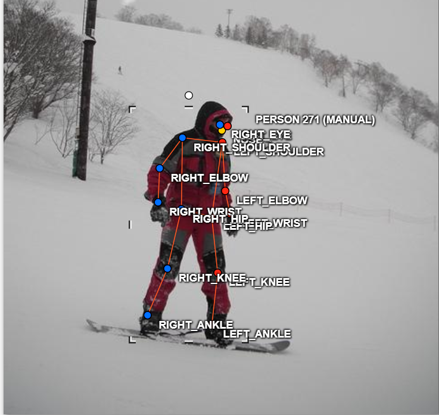
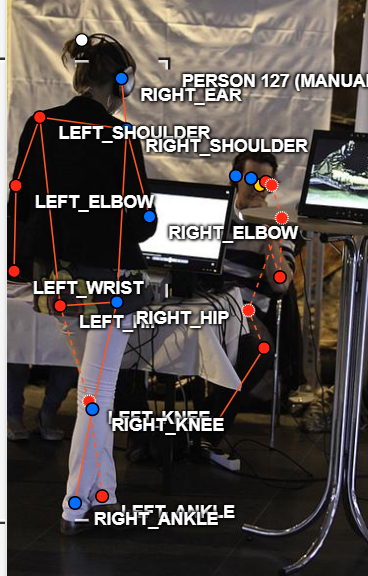
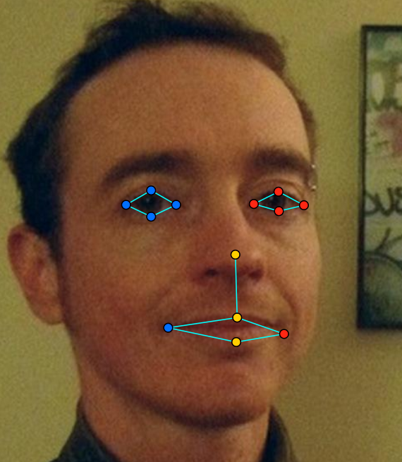
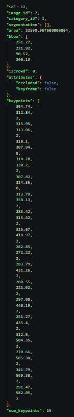

# Báo cáo cá nhân — 2A202603110_NguyenTruongAn

Đổi tên file theo quy tắc `MSSV_HoTen.md`. Ví dụ: `20241234_NguyenVanAn.md`.

Dữ liệu: 12 ảnh người COCO val2017 (Lin et al., 2014) và 8 ảnh chân dung Wikimedia Commons, chỉ dùng trong lớp.

## 0. Thông tin học viên

- Họ tên: Nguyễn Trường An
- MSSV: 2A202603110
- Email: 26ai.annt5@vinuni.edu.vn
- Link repository: https://github.com/nta2112/K5-L2-DAY04-NguyenTruongAn-2A202603110-KeypointPose
- Phiên bản CVAT (Help → About): v2.74.1
- Máy: hệ điều hành Window · RAM 8 GB · chạy CVAT lite
- Bộ ảnh (`src/exports/assignment.json` do `lab.py setup` tạo): có 
- Giờ bắt đầu: 4:40pm 
- Giờ kết thúc: 7:00pm

## 1. Kiểm tra label (CP0)

| Label | Kiểu | Số điểm | Tên điểm đúng bảng của lab? | Đúng thứ tự? | Số cạnh |
|---|---|---:|---|---|---:|
| `person` | Skeleton | 17 | Có | Có | 19 |
| `face` | Skeleton | 13 | Có | Có | 13 |

Mẫu `person` dựng theo người quay mặt về camera (các điểm `left_*` nằm bên phải khung mẫu): Có 

Cách đổi cờ `occluded` / `outside` cho **một điểm** trên phiên bản CVAT này (một câu): Chọn skeleton, chọn điểm cần đổi rồi bật cờ Occluded hoặc Outside trong thuộc tính của điểm; chỉ điểm đó thay đổi trạng thái.

## 2. Số lượng đã gán và thời gian (CP1, CP2)

| Nhóm ảnh | Số ảnh | Số skeleton đã gán | Số người dưới 60 px (không gán) | Số poster / gương / màn hình bỏ qua | Thời gian (phút) |
|---|---:|---:|---:|---:|---:|
| `easy` | 5 |5 |0 | 0|30 |
| `occluded` | 3 |6 |0 |0 |30 |
| `back` | 2 |4 |3 | 0|30 |
| `small` | 1 |0 | 8| 0| 3|
| `crowd` | 1 |3 | 0| 0|10 |
| `faces` | 8 |8 | — |0 | 15|

- Số ảnh người đã xong ở mốc phút 105: 11 / 12
- Thời gian thực tế (phút): CP1 110 · CP2 15 · CP3 20
- Ảnh tốn thời gian nhất là ảnh nào 000000332273.jpg, vì có nhiều người và các điểm nằm ở bị trí gây bối rối khi phải gán, chọn do khuất nhưng vẫn có thể suy ra được.

## 3. Bảng ca khó (CP1, CP2)

Mỗi điểm bạn phân vân một dòng, nhất là phân vân giữa `v = 1` và `v = 0`, hoặc không chắc hướng người.

| Ảnh | Người / mặt | Điểm | Cờ đã chọn | Phân vân giữa | Lý do chọn |
|---|---|---|---:|---|---|
| `000000188804.jpg` | person #2 | `left_wrist` | `v=1` | `v=0` | Bị che một phần nhưng suy ra được vị trí. |
| `000000188804.jpg` | person #2 | `left_shoulder` | `v=1` | `v=0` | Bị che khuất bởi vật nhưng suy ra được vị trí. |
| `000000332273.jpg` | person #3 | `right_hip` | `v=0` | `v=1` | Bị che khuất, không thể suy đoán chắc chắn. |

## 4. Bảng tự review (CP3)

Đi từ ảnh cuối về ảnh đầu. 5 ảnh người (ít nhất 2 ảnh `back` hoặc `crowd`) và 3 ảnh mặt. Ít nhất 8 dòng, kể cả dòng `ok`. Ghi lỗi trước, sửa sau.

Mã lỗi dùng đúng một trong: `lr_swap`, `vis_flag`, `position`, `missing`, `extra`, `ok`.

| Ảnh | Người / mặt | Điểm | Mã lỗi | Ghi chú | Đã sửa? |
|---|---|---|---|---|---|
| `000000572411.jpg` | ko có người | thiếu người | `missing` | Đã hỏi lab coach và bảo là ko cần gán vì quá nhỏ | Không cần sửa|
| `000000023424.jpg` | person #2 | left/right toàn người | `lr_swap` |Đã kiểm tra lại hướng trái/phải của người | Không cần sửa vì là người quay lưng|
| `000000332273.jpg` | person #3 | ankle | `lr_swap` |Đã kiểm tra lại hướng cặp cổ chân |  Không cần sửa, do vị trí đặt khiến code báo lỗi. |
| `000000188804.jpg` | person #1 | ankle | `ok` | Đã kiểm tra, chân thực sự bắt chéo hoặc trái/phải đúng | Không cần sửa |
| `000000399983.jpg` | person #1 | wrist | `lr_swap` | Đã kiểm tra lại hướng | Không cần sửa |
| `face_125051.jpg` | face #1 | mắt | `ok` | Đã kiểm tra 13 điểm, trái/phải và vị trí mí mắt | Không cần sửa |
| `face_425647.jpg` | face #1 | miệng | `ok` | Đã kiểm tra hai khóe miệng | Không cần sửa |
| `face_92028.jpg` | face #1 | toàn bộ mặt | `ok` | Đã kiểm tra toàn bộ keypoint khuôn mặt | Không cần sửa |

Tổng hợp số lỗi theo mã:

| `lr_swap` | `vis_flag` | `position` | `missing` | `extra` | `ok` |
|---:|---:|---:|---:|---:|---:|
|3 |0 | 0|1 |0 | 4|

Điểm còn phân vân giữa `v = 1` và `v = 0` (ghi cả hai lựa chọn và lý do chọn): Ảnh 000000332273.jpg người nằm xuống bị che khuất hông dưới đất. Đã gán right_hip v=0 do ko ước lượng được. Nếu có chỉ chọn v=1 do ước lượng đc.

## 5. Kiểm file xuất và kết quả tự kiểm (CP4)

Tự kiểm tay trong file JSON:

| File | Người / mặt kiểm (ảnh, thứ tự) | Số phần tử `keypoints` | Điểm `outside` ra `v = 0`, `occluded` ra `v = 1`? | `num_keypoints` khớp? |
|---|---|---:|---|---|
| `NguyenTruongAn_persons.zip` | `000000023424.jpg`, person #1 | 51 | Có | Có |
| `NguyenTruongAn_persons.zip` | `000000188804.jpg`, person #1 | 51 | Có | Có |
| `NguyenTruongAn_faces.zip` | `face_125051.jpg`, face #1 | 39 | Có | Có |

Sau khi xuất, CVAT ghi `occluded` thành `v = 1` và `outside` thành `v = 0`. Tọa độ của điểm `outside` trong file là tọa độ cũ.

Hai job đã chuyển sang completed trên CVAT? Có

Dán phần **TÓM TẮT** in ra từ `src/check_submission.py`:

```text
----- TÓM TẮT (dán vào báo cáo mục 5) -----
- File person: NguyenTruongAn_persons.zip
  Số ảnh: 12 · số skeleton `person`: 18 · mỗi annotation 51 số
  Skeleton theo ảnh: 000000021235=1, 000000023424=2, 000000091637=2, 000000150500=1, 000000188804=2, 000000189365=2, 000000210604=2, 000000332273=3, 000000365099=1, 000000399983=1, 000000451084=1, 000000572411=0
  Cờ v: v=2 237 (77%) · v=1 26 (8%) · v=0 43 (14%)
  num_keypoints trung bình: 14.6
- File face: NguyenTruongAn_faces.zip
  Số ảnh: 8 · số skeleton `face`: 8 · mỗi annotation 39 số
  Skeleton theo ảnh: face_125051=1, face_186226=1, face_223746=1, face_425647=1, face_476363=1, face_483667=1, face_92028=1, face_99874=1
  Cờ v: v=2 94 (90%) · v=1 10 (10%) · v=0 0 (0%)
  num_keypoints trung bình: 13.0
- Ghi chú: 43 điểm v = 0 vẫn mang tọa độ cũ (CVAT 2.x xuất như vậy; chuẩn COCO ghi 0, 0). Không phải lỗi: điểm v = 0 bị bỏ qua khi huấn luyện và khi chấm.
- Số [LỖI]: 0 · số [CẢNH BÁO]: 6
Kết quả: ĐẠT (đọc lại từng cảnh báo ở trên)
```

Các `[CẢNH BÁO]` còn giữ nguyên và lý do:

- `000000023424.jpg` person #1 và #2: kiểm tra lại trái/phải; giữ nguyên nếu các điểm đã đúng theo hướng người.
- `000000188804.jpg` person #1: kiểm tra cặp ankle; giữ nguyên nếu chân bắt chéo thật, không phải đảo nhãn.
- `000000332273.jpg` person #3: kiểm tra cặp ankle; giữ nguyên nếu chân bắt chéo thật.
- `000000399983.jpg` person #1: kiểm tra cặp wrist; giữ nguyên nếu tay bắt chéo thật hoặc cặp trái/phải đúng.
- `000000572411.jpg`: không có skeleton; giữ nguyên nếu đã kiểm tra và tất cả người trong ảnh đều dưới 60 px, nên không thuộc đối tượng cần gán.
## 6. Ảnh chụp màn hình

1. Label `person` trong label constructor (đủ 17 điểm có tên):

   

2. Một người quay lưng đã gán, cờ đã đặt:

   

3. Một khuôn mặt đã gán 13 điểm, phóng to vùng mắt:

   

4. Một đoạn JSON xuất của một người:

   

Nguồn ảnh: COCO val2017 / Wikimedia Commons.

## 7. Tự đánh giá

1. Lỗi bạn mắc nhiều nhất hôm nay, và cách bạn sẽ tránh ở dự án thật:

   Lỗi đánh sai v=1, v=0 ở thời gian đầu

2. Một quy tắc bạn đề xuất thêm vào guideline (kèm ảnh ví dụ nếu có):

   Khi người bị che, cần phân biệt `occluded` và `outside`: nếu suy ra được vị trí thì dùng `v=1`, còn nếu không thể ước lượng chắc thì dùng `v=0`. Ví dụ: ảnh `000000188804.jpg`.

3. Nhãn của bạn đi vào model ở đâu? Chọn một lỗi bạn đã sửa và nói nó sẽ làm model học sai thế nào (heatmap, trọng số trong loss, hay bước lật ảnh):

  Tôi đã sửa lỗi `vis_flag`. Dù ko xuất hiện bên trên bởi đã khắc phục lỗi này trước cả khi export. Nhãn keypoint được dùng để tạo heatmap mục tiêu và tính loss khi huấn luyện model. Nếu một điểm đáng lẽ `v = 0` hoặc `v = 1` nhưng lại để `v = 2`, model sẽ bị buộc học một vị trí không chắc chắn như thể đó là nhãn chính xác. Ngược lại, nếu đặt `v = 0` cho một điểm có thể nhìn thấy hoặc ước lượng được, điểm đó sẽ bị bỏ qua trong loss và model không học được vị trí của khớp.

## 8. Khó khăn và lỗi kỹ thuật

Ko có khó khắn gì nhiều. Lúc ban đầu gán bị nhầm lẫn giữa đánh V=1 và v=0 nhưng đã sửa lại trước khi export. 

## Bonus (nếu làm)

### B1 — 3 ảnh người khó thêm

| Ảnh | Số skeleton | Số người dưới 60 px | Ca khó nhất |
|---|---:|---:|---|
| | | | |
| | | | |
| | | | |

Kết quả `src/check_submission.py` cho `HoVaTen_bonus_persons.zip`:

```text
(dán ở đây)
```

### B2 — 5 ảnh khuôn mặt đen trắng / hồng ngoại

Ảnh không màu khó hơn ở điểm nào? Kính râm trên ảnh hồng ngoại có còn là `v = 1` không?

...

### B3 — Model so với nhãn của tôi (không tính điểm)

- Demo đã dùng:
- Ảnh đã thử:

1. Model có trả điểm cho khớp bị che, hay khớp ngoài ảnh không? Confidence ở các điểm đó thế nào?

   ...

2. Với người quay lưng, model có đổi trái/phải không?

   ...

3. Bộ điểm của model có giống 17 điểm COCO không?

   ...

## 9. Tài liệu tham khảo và công cụ AI đã dùng

Cvat
